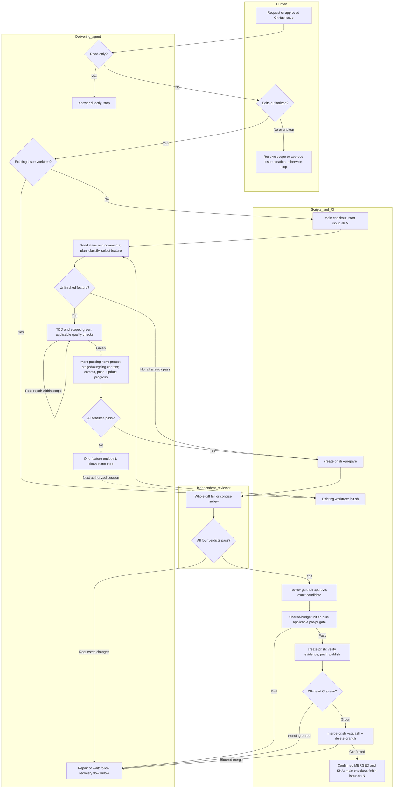
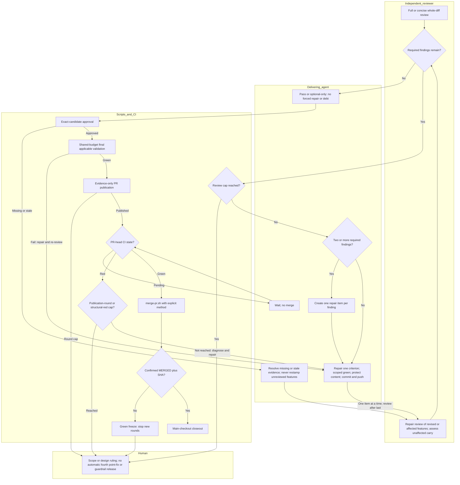
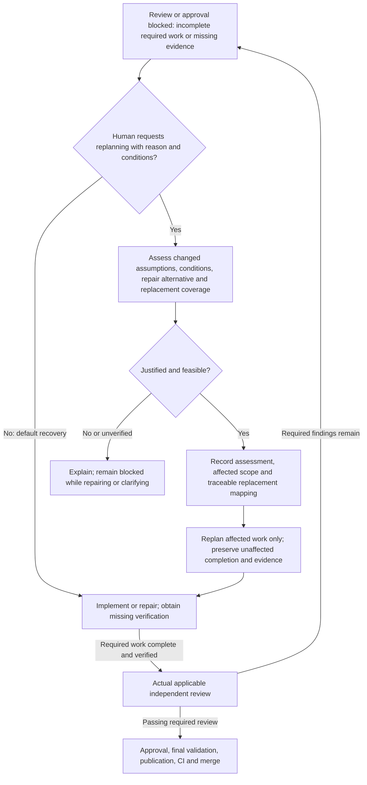
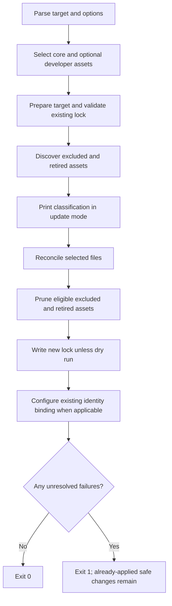
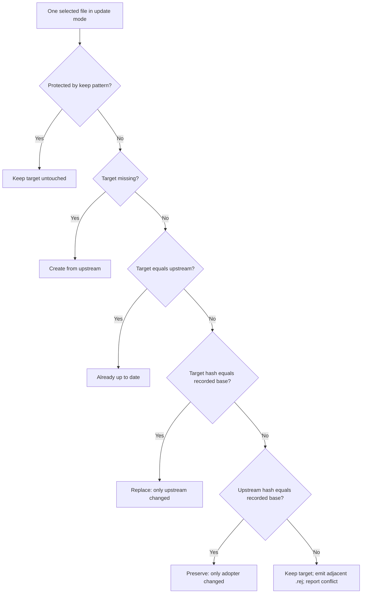

# Copilot Harness Lifecycle

This repository is a reusable harness for issue-driven Copilot work. The harness keeps the
project contract in GitHub Issues, the implementation isolated in per-issue worktrees, and the
agent steering loop grounded in local sensors.

This is the central human workflow guide. The
[agent lifecycle](../.copilot/instructions/harness.instructions.md) owns operational
requirements; scripts and the [frozen contract](harness-contract.yml) enforce
mechanically checkable rules. Generic workflow defaults do not replace them.
For adoption and prerequisites, use [getting started](getting-started.md);
for prompt invocation, use the [Copilot guide](github-copilot.md).

## Lifecycle

One delivering agent owns an issue; a fresh-context independent reviewer judges
the completed diff. A normal session delivers **one feature and stops if work
remains**. When all features pass, including on entry, it continues through
review and authorized closeout. Read-only questions/reviews need no issue pipeline.



### Workflow stages

Commands below use public entrypoints under `scripts/`, from the issue worktree
unless stated otherwise. The agent runs them on the human's behalf within
authorized scope; a routine milestone is not another approval pause.

| Stage / actor | Input | Action | Evidence or next state |
| --- | --- | --- | --- |
| Route / human + agent | Request and authority | Answer read-only work directly. For chat-driven edits, follow [authorization](../.copilot/instructions/harness.instructions.md#authorization). | Approved existing issue or authority to create it; unresolved decisions stop edits. |
| Start / script | Approved issue number | From **main checkout**, `./scripts/start-issue.sh N`; enter printed worktree. Cloud work prefixes startup with `REQUIRE_AZ=1`. | Green preflight, identity, isolated branch/worktree and tracking scaffold. |
| Resume / agent + script | Existing worktree and tracking | Enter it; `./scripts/init.sh`; read progress, plan, feature list and Git history. | Current environment/state recovered, not assumed from old prose. |
| Plan/select / agent | `gh issue view N --json body,comments` and project contract | Choose minimum correct path, classify impact, resolve real decisions, derive criteria/sensors; select one unfinished item. | [Breakdown](#the-breakdown-flow-plan--clarify--feature_list) and fixed pre-edit base in local tracking; all-pass entry goes to prepare. |
| Implement/check / agent | One criterion and fixed base SHA | TDD for behavior; `./scripts/run-sensors.sh green --declared <sensors> --diff <feature-base-sha>` plus applicable quality checks. Prose needs semantic review, not invented tests. | Runner-owned scoped green, discriminating regression evidence and real-boundary evidence when applicable. Red cannot become `passes:true`. |
| Complete feature / agent | Verified changes | Inspect staged content and all outgoing commits/metadata **before commit/push**; mark actual item passing, sign commit, push, update progress. | Clean state, verified commit/remote, truthful tracking. If items remain, **stop this session**; next session resumes. |
| Prepare / script | All feature/repair items passing | `./scripts/create-pr.sh --prepare`. | Synchronized candidate; conflicts stop without publishing. No sensors, push or approval in this step. |
| Review/repair / independent reviewer + agent | Prepared whole diff, issue criteria and scoped evidence | Independent `full`/`concise` review; agent handles required repairs and obtains scoped `repair` review. | Four per-feature verdicts, including applicable security and whole-diff exposure judgment; see [recovery](#review-and-recovery) and [review reference](#review-gate). |
| Approve / agent + script | Passing independent records at reviewed candidate | Check HEAD, record returned verdicts; `./scripts/validation/review-gate.sh approve`. | Exact-HEAD approval and valid unaffected carry if needed. Approval runs no tests. |
| Final validation / script | Approved unchanged HEAD | Run the shared-budget command below. | Green detected profile checks and runner-owned, nonempty **applicable** pre-PR evidence at that exact HEAD. |
| Publish / script | Clean approved and validated candidate; protected PR text | `./scripts/create-pr.sh --title "..." --body-file <local-body-file>`. | Exact candidate pushed and PR opened; wrapper verifies evidence, never synchronizes or runs tests. |
| CI / scripts + agent | Published PR head | Wait for registered checks; investigate red checks under the recovery rules. | Green remote checks, including completed harness CI, before any merge. Pending/red is not merge permission. |
| Merge / script | Green checks and authorized closeout | `./scripts/merge-pr.sh --squash --delete-branch`. | Authoritative MERGED state and merge SHA, not merely a successful-looking command. |
| Close / script | Live merge evidence | From **main checkout**, `./scripts/finish-issue.sh N`. | Write-once conclusion and durable progress survive safe worktree teardown. Do not stop at "PR ready". |

Final validation is one required run, not separately reset budgets:

```sh
./scripts/validation/validate.sh bash -euc \
  './scripts/init.sh; ./scripts/run-sensors.sh --gate pre-pr'
```

The hard test budget is **900 seconds**; **600 seconds is a performance target**.
Do not reset it or remove coverage to fit. Installation/build/static phases are
excluded as specified in the [budget reference](#shared-test-execution-budget).
Final selection is the complete applicable set, not the old full inventory.
New candidate changes need corresponding review, approval and final evidence.

### Review and recovery

Use the lifecycle's [review acceptance policy](../.copilot/instructions/harness.instructions.md#review-acceptance-policy):
`concise` and `full` change report depth, not the finding pass. Security is
risk-triggered, including approval controls and CI/workflows. Supported
BLOCKING/CRITICAL/MAJOR findings need repair; MINOR feedback and unsupported
suspicions are optional. Static proof may suffice; unsafe reproduction is not
required. Optional-only feedback needs no repair item or debt entry.



The reviewer checks **all intervening changes**, including shared dependencies,
before carrying an unaffected feature's original verdict. It returns the
original SHA and impact rationale on a real passing repair event bound to the
candidate; changed/affected features require review. Unchanged paths alone and
fabricated fresh passes are insufficient. If it adds tests, the agent validates
and commits them, then gets verdicts for that resulting candidate.

Final validation failure is not approval: repair with scoped checks, obtain
relevant repair review and fresh approval, then rerun the applicable final gate.
Pending CI means wait; red CI means diagnose, not merge. Repeated same-class
failures require [approach reassessment](../.copilot/instructions/harness.instructions.md#same-class-escalation).
Review reject caps and post-PR round/structural-red caps require a human design
ruling. A merge failure after green CI freezes further publication rounds;
do not make speculative commits or silently release the freeze.
See [publication/merge enforcement](../.copilot/instructions/harness.instructions.md#publication-and-merge-enforcement)
for exact caps, permitted releases and merge provenance.

#### Human-requested replanning at blocked review

This branch starts **only at blocked review/approval**, not at every failed
test or CI run. The lifecycle's
[blocked-review recovery rule](../.copilot/instructions/harness.instructions.md#blocked-review-recovery)
owns the decision. Missing verification normally needs verification, not a new
plan; an incomplete required item cannot be approved.



For example, an unrun integration check calls for that check. If the owner
prohibits a planned provider but the required outcome remains unchanged, assess
a permitted alternative and map affected requirements/dependencies before
replanning; the owner constraint needs no prohibited provider call. An
unsupported claim that the implementation is impossible does not unblock
approval: check the technical claim where feasible or clarify it.

Record the reason, conditions, assessment and replacement mapping in existing
issue/progress records. Removing or weakening a requirement needs explicit
owner approval in the authoritative issue. Replanning alone never changes
`passes:false` to `passes:true`, fabricates a reviewer failure or waives required
work. Preserve applicable unaffected evidence and
[scoped-review carry-forward](#review-gate). The revised behavior still goes
through implementation, tests, independent review and normal gates; existing
escalation and safety/authorization stops remain intact.

Detailed installation, language, sensor, tracking and trace references follow.

## Installer reference

### What this file does

[scripts/install/install-harness.sh](../scripts/install/install-harness.sh)
installs and upgrades harness assets inside another project while preserving
adopter customizations. The public
[scripts/install-harness.sh](../scripts/install-harness.sh) entrypoint forwards
its arguments to that implementation.

The installer copies explicitly selected files, tracks upstream SHA-256 hashes,
classifies local versus upstream changes, and removes obsolete assets only with
the required hash or ownership proof. It does not install application
dependencies, run quality gates, or commit changes.

The core payload comes from
[install-harness.assets](../scripts/install-harness.assets).
`--with-dev-sensors` adds
[install-harness.dev.assets](https://github.com/weijen/agent-delivery-harness/blob/main/scripts/install-harness.dev.assets).
Most assets retain their source paths; the installed harness smoke workflow
comes from [profiles/adopter-smoke.yml](../profiles/adopter-smoke.yml).

### Modes and execution flow

| Mode | Behavior |
| --- | --- |
| No flag | Preview changes without modifying the target; the target must already exist. |
| `--write` | Create missing files, leave matching files alone, and refuse differing files. |
| `--update` | Apply upstream-only changes, preserve adopter-only changes, and report conflicts. |
| `--with-dev-sensors` | Add optional developer assets to either write mode or a dry run. |

Both write modes also prune eligible obsolete assets. Repeat the developer flag
on upgrades to retain that profile; omitting it makes previously installed
developer assets candidates for ownership-safe removal.

Most of the implementation defines helper functions. Execution starts with
argument parsing near the bottom:



### How updates decide what to change

`reconcile()` compares current upstream content, the adopter's target file, and
the previously recorded upstream hash (the base). The shared
[reconcile library](../scripts/lib/reconcile-lib.sh) handles basic
missing, matching, dry-run, and write-mode cases.



This is hash-based classification, not an automatic text merge. Differing files
without a recorded base are conflicts, even if their edits could be merged.

| Bookkeeping file | Purpose |
| --- | --- |
| `.harness-lock` | Record upstream hashes and relative paths, not old file contents. |
| `.harness-keep` | Reserve adopter-owned paths using shell-style glob patterns. |
| `<path>.rej` | Show an unapplied upstream change or deletion as a unified diff. |

After successfully emitting a rejection, the lock records the current upstream
hash, or `deleted` for a rejected deletion. An unchanged repeat against the same
upstream then recognizes the retained file as an adopter customization.

### Retirement and safety limits

Excluded assets are files no longer selected for the current installation.
The `MANAGED_CLEANUP_PATHS` array bounds excluded-asset discovery; it does not
select the installation payload.
Their removal requires a matching installed lock base. Retired assets are
explicit upstream deletions recorded in
[install-harness.tombstones](../scripts/install-harness.tombstones); matching
tombstone content proves an unmodified copy, while update mode can also use a
matching lock base.

Claude integration is retired, but its ledger entries remain migration
metadata. Those paths are discovered even when the source bundle is absent.
Claude retirement always requires installed lock ownership, not merely matching
tombstone bytes. Modified, protected, and unknown-owner copies are preserved.
The installer rejects `--with-claude` and never rewrites adopter hook settings.

Path validation and symlink checks protect write destinations. Each replacement
uses a staged temporary file and rename, but the installation as a whole is not
transactional: a conflict does not roll back safe changes already applied.
Dry runs use temporary bookkeeping outside the target without modifying it.

There is one project-configuration exception to asset copying: when the target
is a Git repository with an existing GitHub identity binding, the installer can
configure Git and append an identity-file ignore entry to an existing
`.gitignore`.

## Harness Layers

The harness is organized in three layers so that stable lifecycle behavior stays
separate from replaceable language support and project-specific conventions:

- **Core Harness** — the language-neutral lifecycle: preflight, per-issue
  worktrees, local progress tracking, the review gate, and PR closeout. Its
  behavior is frozen in the machine-readable contract
  [docs/harness-contract.yml](harness-contract.yml) and guarded by
  `tests/scripts/lifecycle/test_harness_contract.sh`. The owner scripts
  (`scripts/lib/issue-lib.sh`, `scripts/lib/trace-lib.sh`,
  `scripts/lifecycle/start-issue.sh`, `scripts/validation/check-feature-list.sh`,
  `scripts/validation/review-gate.sh`, `scripts/lifecycle/create-pr.sh`,
  `scripts/lifecycle/merge-pr.sh`, `scripts/lifecycle/finish-issue.sh`) must stay
  language-neutral. The `scripts/` language & structure policy — what stays
  bash, what may become Python (trigger-based), and the split thresholds — is
  recorded in
  [the upstream contributor policy](https://github.com/weijen/agent-delivery-harness/blob/main/docs/scripts-language-policy.md).
- **Language Profiles** — declarative descriptors in `profiles/<id>.profile.sh`
  that supply surface labels, dependency sync, and gate commands after
  `init.sh`'s explicit marker checks select a project surface. The
  shipped set is **Python and Node.js** (proven adopters); **Go, Java, and Ruby**
  are generator-supported — regenerate them on demand with
  `scaffold-language.sh`. The lifecycle core stays language-neutral, while the
  current preflight enumerates marker files and loads the matching profile. See
  [profiles/README.md](../profiles/README.md) for the descriptor contract and
  [docs/multi-language-profiles.md](multi-language-profiles.md) for the design.
- **Framework Templates** — project-specific conventions layered on top of a
  profile (e.g. FastAPI/Django for Python, Spring Boot/Quarkus for Java). These
  live in the adopting project's own docs and instruction files, never in the
  core. A profile only declares framework *hints*; it never forces a framework.

### Adding or updating a language profile

Use the generator rather than hand-copying assets:

```sh
./scripts/scaffold-language.sh <python|go|node|java|ruby>          # dry run
./scripts/scaffold-language.sh <profile> --write                  # create missing assets
./scripts/scaffold-language.sh <profile> --update                 # overwrite a differing asset (after showing the diff)
```

The generator is idempotent and conservative: it refuses unknown profiles, does
not overwrite project-specific files without `--write`, creates or updates the
matching `.copilot/instructions/<language>.instructions.md`, reports the gates the
profile adds to `init.sh`, and leaves the issue / worktree / review-gate scripts
untouched. After adding a profile, add a `tests/scripts/test_<id>_profile.sh`
regression sensor and extend the multi-surface `tests/scripts/lifecycle/test_init_gates.sh`
e2e fixture so the new surface is exercised.

### Non-regression contract

The public preflight path `scripts/init.sh` is a thin `exec` entrypoint for
`scripts/lifecycle/init.sh`. Both inspect their own checkout from any invocation
directory, including linked worktrees. Its matching sensor lives under
`tests/scripts/lifecycle/`; no duplicate flat implementation is retained.
Likewise, `scripts/start-issue.sh` forwards to `scripts/lifecycle/start-issue.sh`.
Startup anchors to the invoked checkout and rejects a linked checkout before
switching to the main root or creating issue state.
`scripts/create-pr.sh` forwards to `scripts/lifecycle/create-pr.sh`, preserving
the caller's Git checkout and relative arguments, including nested directories
in linked worktrees. Publication still consumes existing approval and sensor
evidence without rerunning tests or rewriting the candidate.
`scripts/merge-pr.sh` likewise forwards to `scripts/lifecycle/merge-pr.sh`.
Both preserve the caller's checkout, require green CI and authoritative merge
confirmation, and keep branch cleanup safe for linked worktrees.
`scripts/finish-issue.sh` forwards to `scripts/lifecycle/finish-issue.sh`.
Closeout anchors to the invoked checkout and refuses a linked checkout before
resolving the main root, migrating progress or removing any worktree.
The public installer `scripts/install-harness.sh` forwards to
`scripts/install/install-harness.sh`; installer sensors live under
`tests/scripts/install/`. The implementation resolves its own installed source,
not the caller's cwd. Exact asset manifests and the tombstone ledger remain at
their existing `scripts/install-harness.*` data paths.
`scripts/scaffold-language.sh` likewise forwards to
`scripts/install/scaffold-language.sh`, generating profiles in its own source
checkout or installed repository rather than the caller's directory.

The frozen lifecycle in [docs/harness-contract.yml](harness-contract.yml) is the
single source of truth for Core Harness behavior. Before changing any lifecycle
script, keep these sensors green:

- `tests/scripts/lifecycle/test_harness_contract.sh` — scripts still satisfy the contract
  (required scripts exist and parse; the four gates, SHA bindings, audited
  bypasses, and environment flags still match their owners; owner scripts stay
  language-neutral).
- `tests/scripts/lifecycle/test_init_gates.sh` — `init.sh` still detects every surface and
  runs the matching gates.

The sensor inventory (`test_*.sh` recursively under `tests/scripts/` and
`tests/meta/`, excluding `lib/`, `helpers/` and `fixtures/` subtrees)
feeds applicable source CI; a green CI run is a hard precondition for merge
(see [CI Boundary](#ci-boundary)). Installed smoke retains its portable inventory.
The canonical inventory comes from
`scripts/validation/affected-sensors.sh --list`. Empty final suites fail; empty
scoped selections remain valid.
Affected resolution selects from that same sensor set, including relocated
sensors but never helpers. Feature greens require an explicit fixed feature
base: record `git rev-parse HEAD` before the first edit, then use that SHA for
every green of that feature, including after partial commits. Earlier completed
features do not remain in scope just because the branch still differs from main.
Shared libraries and schema/contract authorities use the same scoped mapping,
not a FULL fallback. Discovery/read errors and invalid declarations stop the run.

Real whole-suite wrappers, including installed-profile validation, declare
`# harness-sensor-stage: boundary` in their leading comment header. They remain
in canonical discovery for applicable final pre-PR and CI, but are deferred from feature
selection. Declaring one as feature coverage fails explicitly rather than
silently dropping it. Feature greens retain targeted runtime e2e and miniature
hermetic fixtures that exercise full-runner behavior. This stage separation
does not remove assertions or authorize reusing boundary-gate evidence.

### Sensor selection dispositions

The selector retains canonical inventory through `--list`. Its
`--gate pre-pr --diff <base>` form resolves routine checks plus checks affected
by that change; `--gate release` resolves release/upgrade acceptance, and
`--gate maintenance` resolves explicit maintenance checks. These are selection
interfaces, not commands that execute tests.

The local runner executes these sets through `--gate pre-pr`, `--gate release`
and `--gate maintenance`. Pre-PR derives the change from the candidate's merge
base with the already available `origin/main`; missing base discovery is an
error, and final callers cannot narrow the result through declarations or a
different `--diff`. `--gate ci --diff <pull-request-base>` uses the same policy
with the workflow's explicit base. Neither command fetches or enforces new
remote freshness requirements. Gate summaries/evidence use `scope=applicable`,
not `full`; historical full evidence stays readable. A missing selected sensor
is a failure, never a successful skip.

Leading sensor comments declare `# harness-sensor-trigger: routine`,
`relevant`, `upgrade`, or `maintenance`; omission means `routine`.
`# harness-sensor-depends: <space-separated repository-relative paths/globs>`
records bounded known dependencies.
`# harness-sensor-deletes: <paths/globs>` declares deletion-only obligations,
including the managed paths protected by tombstone history. Diff-based selection
distinguishes committed, staged and unstaged deletions from ordinary updates.
Explicit path arguments carry no status, so conservatively satisfy either
dependency kind. Nonroutine dispositions require at least one dependency kind.
Neither path matching mechanism claims a transitive graph.
A changed sensor always selects itself. Routine feature selection retains the
existing text/path matching, augmented by declared dependencies. Nonroutine
selection uses declared paths rather than incidental prose basename matches.
Invalid metadata fails visibly; declarations are not a transitive dependency
graph or proof that every unknown dependency has been found. The independent
stage header still excludes whole-suite wrappers from feature greens.

| Candidate | Distinct failure protected | Disposition and trigger |
| --- | --- | --- |
| Audit sweep | Offline report-only dispatch and report consolidation | Maintenance; driver, prompt, skills or active contract changes |
| Log-review recipes | Incorrect transcript durations and inventory | Maintenance; recipes, transcript fixtures or trace contract changes |
| Archived reports | Restored live reports or broken archive links | Maintenance; archived content or former report paths |
| Economics spans | Incorrect closeout aggregates or fabricated usage | Relevant; finish/report/trace helpers, schema and active contracts |
| Release workflow and lock synchronization | Unsafe release wiring or stale release lock | Upgrade; release/toolchain inputs, release contract, or explicit release |
| Tombstone history | Missing or malformed historical retirement ledger | Upgrade; installer/retirement inputs, managed-path deletions, layout contract, or explicit release |
| Historical v0.36.0 and v0.45.2 upgrades | Lost adopter ownership, unsafe migration or broken installed runtime after upgrade | Upgrade; installer manifests, reconciliation/identity/runtime dependencies, layout contract, or explicit release |
| Other lifecycle, schema, redaction, evidence and installed integration checks | Their retained runtime contracts | Routine final validation; affected/declared feature selection |
| Bounded evaluation-driver contracts | Incorrect manifest, blocking result or scorecard behavior | Routine; real whole L0 evaluation remains explicitly invoked through its existing driver |

### Shared test execution budget

One required validation run has a fixed **900-second cumulative test wall-time
budget**. Sequential profiles and sensors share the remaining time; nested
execution joins the active phase and parallel work counts elapsed union, not
summed worker/CPU time. Local and CI runs have independent sessions, as do
separate TDD iterations. Release, maintenance and explicit evaluation runs obey
the same limit. Selection and assertions are not reduced to fit the deadline.

600 seconds remains a performance target, not an execution cutoff. A run may
exceed that target while retaining all required coverage; the hard limit remains
900 seconds.

Use the single-purpose session entrypoint to compose existing budget-aware gates:

```sh
./scripts/validation/validate.sh bash -euc '
  ./scripts/init.sh
  ./scripts/validation/check-shell.sh syntax
  ./scripts/validation/check-shell.sh lint
  ./scripts/run-sensors.sh --gate pre-pr
'
```

Run this final validation only after independent review approval. The session
wrapper creates/inherits context; it is not a generic timeout for arbitrary
commands. Standard profile test slots, Python gates, sensor runners and evaluation
drivers enter the shared budget themselves. New test commands must use
`budget_run <phase> <command> [args...]` from `scripts/lib/test-budget-lib.sh`
inside the same session. Do not compose a required run from independently
restarted sessions.

Dependency setup and independently executed build/format/lint/typecheck phases
are excluded. Preparation inside an executing test command counts, including
compilation, fixture installation, or nested static work performed by a test.
The core uses a monotonic clock (`/proc/uptime` on Linux, Perl's core
`Time::HiRes` on macOS), not adjustable wall-clock timestamps.

Exhaustion is latched: stop the active test process group, allow one second of
bounded termination grace, then force termination. Emit elapsed milliseconds,
the 900-second budget and active phase; exit 124, start no later tests, and
record no successful gate evidence. Accounting errors also fail closed.
There is no supported limit extension/reset/disable option. Coverage/budget
conflicts require an explicit scope/design ruling, never automatic test deletion.

### Sensor diagnostics

Each nonempty local runner invocation prints a `DIAGNOSTICS <index>` location
and a `SENSOR <path> elapsed_ms=<n> exit_status=<n> log=<path>` record per
attempt. Existing `PASS`/`FAIL` and final `SENSORS` lines retain their meaning.
The index is tab-separated: sensor, elapsed_ms, actual exit_status, log.
Adjacent `run.tsv` records HEAD, mode and scope; a unique run directory prevents
repeated attempts from overwriting each other. Elapsed wall time includes
output capture/redaction, not just CPU execution. Individual diagnostic timings
are not per-sensor pass thresholds; the separate aggregate test budget is hard.

Logs are sanitized before writing and retained beneath the main checkout's
ignored `.copilot-tracking/issues/issue-NN/sensor-runs/` directory, surviving
issue-worktree removal. Without issue context they use
`.copilot-tracking/sensor-runs/`. Run directories are private (0700).
Credential-shaped quoted lines (including single-quoted keys), quoted-value
continuations through an unescaped matching delimiter, and multiline private
keys are withheld. Unterminated quoted credentials stay withheld through EOF;
other known secret shapes use the shared trace redactor. Redaction is not a
license to print arbitrary sensitive data: sensors must not dump environments,
customer data or credentials. Diagnostics remain local, never commit/upload them
without a separate exposure check.

Storage/redaction failures print explicit warnings and `log=unavailable`.
The runner drains discarded output without rerunning the sensor or substituting
a capture exit code for the sensor's exit. The gate still reflects sensor results;
a failing sensor never creates green evidence. Diagnostic indexes are not gate
evidence and cannot authorize publication. CI retains its selected coverage within
the shared test session.

On failure, the runner prints the first and last ten sanitized lines (at most
200 bytes per displayed line), with an omission marker when necessary. This
preserves early causes and final assertions without flooding the terminal.
The retained log remains complete; successful output is retained but not dumped.
Diagnostics never execute a sensor a second time.

Use the exact index path printed by the run, from any working directory:

```sh
index="/path/printed/by/DIAGNOSTICS/sensors.tsv"
# Slowest attempted sensors, descending elapsed_ms.
tail -n +2 "$index" | sort -t "$(printf '\t')" -k2,2nr | sed -n '1,10p'
# Failed attempts and their complete sanitized output paths.
awk -F '\t' 'NR > 1 && $3 != 0 { print $1, "exit=" $3, "log=" $4 }' "$index"
```

Timing overhead is workload- and machine-dependent. Measure paired miniature
fixtures when changing instrumentation; do not run extra real full suites just
to benchmark it. A run's elapsed values include any nested work the sensor does;
they do not count or attribute its individual assertions.

## Planning reference

### The breakdown flow (plan → clarify → feature_list)

The delivering agent derives `feature_list.json` from the issue and chosen approach.
Planning depth follows behavioral risk; no separate plan file is required for a
contained low-risk change. Use the
[workflow classification rubric](../.copilot/instructions/workflow-tiers.instructions.md):
clearly read-only work and clearly low-risk corrections route directly;
other changes need proportionate investigation before determining Tier 2/3.
Known risks and authorization constraints apply during planning too.
Do not proceed while a necessary human decision is unresolved:

1. **Choose the approach before decomposing work.** Start from the observable
   result and how to verify it, not an assumed implementation. Inspect existing
   project capabilities; distinguish confirmed requirements and constraints from
   assumptions about the method. Choose the smallest real input-to-result path
   that can prove the outcome, including necessary correctness, authorization,
   secret protection and data-integrity safeguards from the start. Investigate
   an unknown when it could change that choice, not to exhaust every possibility.
   These are reasoning questions, not required headings or a checklist artifact.
   A clear small task may need only a few sentences; do not manufacture
   alternatives when one approach is sufficient. Keep that short approach in
   progress/chat for low-risk work; write
   `.copilot-tracking/issues/issue-NN/plan.md` when complexity or uncertainty warrants it.
   Conclude planning before implementation by stating the tier, its impact-based
   reason and any missing preparation in existing progress or conversation.
   Extend only missing preparation if risk increases; reuse valid plans and
   evidence when inspection rules out a suspected higher-risk impact. Unchanged
   decisions need no duplicate planning. This is part of choosing the approach,
   not an additional gate, approval pause or classification document. Reassess
   material new findings before crossing an affected boundary; do not claim
   containment while credible critical risk remains unresolved.
2. **Resolve necessary human decisions.** Ask about unresolved requirements,
   authorization or consequential tradeoffs. Do not manufacture an approval pause
   when the issue already provides the needed decisions.
3. **Author the breakdown.** Record each genuine criterion in `feature_list.json`,
   carrying its `regression_sensor` / `e2e_sensor`. One criterion is enough;
   the upper sizing boundary (STOP and propose a split above 5) is single-sourced in
   `harness.instructions.md` §3 step 1.
4. **The GitHub issue stays the contract; `feature_list.json` is the derived breakdown.**

This keeps decisions that need a human in front of the human *before* any breakdown is
committed (#352: one agent owns plan, breakdown, and delivery).

Contained low-risk work uses `concise` independent review over the whole diff;
higher-risk work uses `full`. Both retain the same finding pass, evidence,
current-HEAD approval, final applicable validation and green-CI merge requirements.
See **Risk-proportionate delivery** in `harness.instructions.md`; there is no
alternate tier gate or bypass flag.

#### What counts as one feature

When authoring the breakdown in step 3, granularity is fixed by one rule (the
authority is the *What counts as one feature* subsection in
[.copilot/instructions/harness.instructions.md](../.copilot/instructions/harness.instructions.md)):
a feature is one externally observable acceptance criterion mapped to concrete
executed assertions. Split unrelated concerns, not test files or commands.
Criteria may share existing sensors. One behavioral test may provide regression
and E2E evidence when it actually crosses the required runtime boundary; mocked
unit-only coverage cannot. Retain one independent case per required behavior/failure
scenario, preserving distinct necessary scenarios and identifying retained protection
before retiring a case. Repeated local/TDD/CI execution is not duplicate definition.

## Agent Topology (#352: one agent + one reviewer)

The lifecycle is delivered by **one agent in one continuous context** per issue. It plans,
authors the breakdown, implements with TDD, runs scoped sensors, records its own
`deviation` spans, and drives the boundary scripts. The **only other model
invocation** is `code-review-subagent` — invoked once, pre-PR, over the whole branch diff, in a
fresh context with no visibility into the delivery conversation (that independence is what made
it the harness's most effective defect catcher). `repair`-mode re-reviews after a
`NEEDS_REVISION` are scoped to the revised features. If the runner does not register the
`code-review-subagent` agent name from its `.agent.md` file, the fallback is unchanged: invoke a
fresh (blank/current) subagent and paste the full role contract from the agent file.

The retired conductor/generator/planning role choreography (late-2025 pattern) and its handback
payload protocol are documented in git history; historical traces carrying those role names
remain valid.

## Local Tracking

`.copilot-tracking/` is gitignored local state. It is persistent on the developer machine but never pushed.

During an active issue, the artifacts are deliberately split between checkouts:

- `trace.jsonl` lives under `.copilot-tracking/issues/issue-NN/` in the **main checkout**.
- `feature_list.json`, `plan.md`, and `progress.md` live under the same relative path in the
  **issue worktree**.

Do not look for either group in the other location. Closeout migrates the finalized
`progress.md` to the main checkout before removing the worktree, as described below.

| Path | Purpose |
| --- | --- |
| `.copilot-tracking/issues/issue-NN/feature_list.json` | Per-issue feature breakdown, including `steps`, `passes`, `regression_sensor`, `e2e_sensor`, `blocked_on`, `verification`, and (#449) `type`/`finding_fingerprint` on repair items. Historical lists may still carry the retired `teeth_proof` field (#334) — valid to read, never authored anew. |
| `.copilot-tracking/issues/issue-NN/progress.md` | Running local log of completed features, verification, commits, and next work. |
| `.copilot-tracking/issues/issue-NN/plan.md` | Optional local implementation plan for non-trivial issue work. |
| `.copilot-tracking/plans/*.md` | Local deep-plan documents (multi-issue runs, prompts). |
| `.copilot-tracking/review-gate/issue-NN/approved-head` (issue-scoped; the un-scoped `review-gate/approved-head` survives only as a read-only legacy fallback) | Local marker written by `./scripts/validation/review-gate.sh approve`; must match current HEAD before `./scripts/create-pr.sh` opens a PR. |

`progress.md` includes an Action Log section rendered from trace spans (#332), covering substantive lifecycle actions,
subagent handbacks, verification results, review outcomes, and any deviation stop/report/recover entry.

While an issue is open, the **worktree** copy of `progress.md` is authoritative: `scripts/log-handback.sh` writes
each Action Log line there (see Trace emission below). Before migration,
`./scripts/finish-issue.sh` atomically replaces its first in-flight `Status:`
line with a write-once `Conclusion:` containing `merged` or `abandoned` and the
latest trace-derived review verdict (`APPROVED`, `NEEDS_REVISION`, or `n-a`).
A merged conclusion requires a merged GitHub PR whose head is the exact issue
branch; abandonment requires explicit `ABANDONED=1`. An identical conclusion is
idempotent, while a conflicting conclusion is never overwritten.

`./scripts/finish-issue.sh` then migrates that worktree `progress.md` before `git worktree remove`.
Its `progress_migrate` stage calls `best_effort_progress_migrate` (`scripts/lib/finish-lib.sh`) to copy the file verbatim
into the issue's tracking directory at the **main checkout** root. This mirrors `trace.jsonl`'s survival rationale — a linked worktree is
deleted by teardown, so the migrated main-root `progress.md` survives it the same way `trace.jsonl` does, staying
available for the post-hoc `check-trace-consistency.sh` audit. The copy helper
is failure-atomic and independently warn-only, but closeout treats a missing,
unsafe, unwritable, or failed migration as a hard pre-teardown block. This
prevents worktree removal from destroying the only finalized record.

`scripts/lib/economics-report-lib.sh` retains sourceable helpers that can stamp a **delivery economics** block into an
issue `progress.md` (between `<!-- delivery-economics:start -->` / `<!-- delivery-economics:end -->` markers,
idempotently) from the issue trace and `feature_list.json`. No lifecycle entrypoint invokes these helpers after
the trace reporter's retirement in #419. When invoked directly, the block reports wall-clock span as both
first→last elapsed time and active time (the sum of chronologically adjacent gaps up to and including 30 minutes;
gaps over 30 minutes are excluded in full), token totals with run coverage, review rounds, deviations logged, and feature counts (passes:true). Every row obeys the **omit-never-fake / null-never-0** rule: a metric that was not actually
measured is **omitted entirely** and never fabricated as `0` or a half-present `n/a` placeholder. In particular the
trace-derived token row appears only when a runtime adapter reported `gen_ai.usage.*` on model spans; otherwise it is
omitted — issue #329 retired the old `- Tokens: n/a` line, because a half-present field is worse than an absent one.
These report-time computations and stamps live in
`scripts/lib/economics-report-lib.sh`; `scripts/lib/finish-lib.sh` remains limited to
migration, closeout gates, finalization, teardown orchestration, and state
hygiene.

**Native-record economics join (issue #329).** Because the GitHub Copilot runtime does not carry `gen_ai.usage.*` on
model spans, the helper can also join real token/model economics from the local Copilot **native session records** at
`${COPILOT_CLI_STATE_ROOT:-~/.copilot/session-state}/<COPILOT_AGENT_SESSION_ID>/events.jsonl`, rendered as a clearly
labelled second economics block. Only honest derived aggregates cross into the record, never raw event content: a
**subagent-only** token total (the single `totalTokens` per `subagent.completed` event — never split into a fabricated
input/output pair, and excluding the top-level session), the distinct subagent **model** names with per-model
counts/tokens, and the subagent tool-call and duration sums. A `subagent.completed` record is aggregated **only** when
all four required economics fields are genuinely present with correct types (a non-empty string `model` and
non-negative numeric `totalTokens`/`totalToolCalls`/`durationMs`); an incomplete or malformed record is **excluded
whole**, never mapped to an `unknown` model or a fabricated `0`. The field-presence check is about type/presence, not
content sanity, so a `model` label — untrusted local text — is rendered through a display-only **sanitization**
boundary (`sanitize_model` inside `render_native_economics`): every C0 control character (including CR/LF) is
stripped to a space, runs collapse, ends trim, and the visible label is capped at 60 characters with a `…` marker.
This keeps the markdown block bounded, single-line, and safe against the `<!-- delivery-economics:start/end -->`
markers `economics_stamp_into` matches by exact line equality, while the honest join/grouping in
`compute_native_economics` keeps aggregating on the **raw** model string — cardinality and totals are unaffected by
this rendering-time transform. The join is **windowed** by the issue trace's own
first→last timestamp, so events from other issues in a long shared session are excluded. **AIU** is a windowed delta
of the cumulative `session.usage_checkpoint` / `session.compaction_complete` `totalNanoAiu` counter, emitted **only**
when a checkpoint at/before the window start gives a baseline, at least one checkpoint inside the window shows
movement, AND the window-end value has not decreased below the baseline; a decrease (session reset/rollback) omits the
field entirely (never a negative, never a masked `0`), while an equal value is a genuinely measured zero. When the
session id, the events file, `jq`, the window, or a
field is unavailable (CI, adopter machines), every native field/row **fails open and is omitted** — never zeroed,
never `n/a`. This native-record join **supersedes** the cloud token-capture approach tracked in **#163** (per the #305
direction): #163 is no longer the prerequisite for non-`n/a` token rows but the complementary cloud-side path the local
join now stands in for. The frozen `trace-summary.json` contract remains historical; no current lifecycle entrypoint
generates or aggregates those summaries.

A review round is a distinct logical review event, not a per-feature `review_verdict` span. Events are keyed by
`harness.review_event_id` when present; historical spans without an explicit ID fall back to
`(harness.reviewed_sha, harness.review_mode)`. All verdicts sharing one key form one event, and one failing child
makes the event fail. If any verdict lacks valid and unambiguous event identity — it carries no explicit
`review_event_id`, no valid SHA/mode pair, or has legacy coordinates shared by multiple explicit-ID events — the
Markdown count is `n/a` with identity coverage and the numeric count is omitted with matching coverage fields; no
verdict spans remains a measured `0`. Mixed traces (some explicit IDs, some legacy SHA/mode) use unambiguous bridge
semantics: a legacy span whose coordinates match exactly one explicit event bridges to that event (same logical
event, no double-count); pure legacy coordinates with no matching explicit-ID span retain the SHA/mode fallback;
legacy coordinates shared by multiple explicit-ID events are ambiguous and render the round count `n/a` with the
numeric count omitted.

`./scripts/validation/check-feature-list.sh <N>` is a lightweight feature-list lifecycle guard. It validates that an issue's
`feature_list.json` is well formed — valid JSON object; every `.features[]` item has `id`, `title`, an array `steps`,
and a boolean `passes`; and any `passes:true` feature carries non-empty `verification` text — and reports completion
state. Incomplete (`passes:false`) features are a non-blocking warning by default.
Strict completion (`REQUIRE_FEATURES_COMPLETE=1`) requires available `jq`, a
nonempty `.features` array and all required feature/repair items complete;
missing tooling or an unpopulated list cannot produce successful completion.
Default progress validation retains its warning/skip behavior.
`./scripts/finish-issue.sh` reuses this same check, so the two paths cannot drift. It
is deliberately generic: it does not read project docs, devcontainers, CI, or any sensor registry, and never executes
anything from the feature list.

### Durable class lessons

Repeated failures first prompt reassessment of the approach, not automatic
class-wide hardening. The existing `decompose` disposition permits simplifying or
replacing the approach for any failure class without requiring more machinery.
Prefer regression protection over permanent instructions. Add a one- or two-line
lesson only for recurring, generalizable knowledge code/tools cannot adequately
express; replace obsolete rules rather than accumulating exceptions.
The optional trace path/summary pair remains validated when supplied.

## Gates And Sensors

`./scripts/init.sh` detects Python through its shared profile applicability
function and other project surfaces through explicit marker-file branches.
For each detected language, `profiles/<id>.profile.sh` supplies the surface
label, dependency sync, and local gate commands:

- docs-only: reports that no language gates are present and points agents to shellcheck for touched harness scripts. (markdownlint stays available as optional docs hygiene; it is not a required gate.)
- Python (source or product configuration): `uv sync --all-groups`, ruff format/check, mypy, and pytest. Non-package uv release metadata alone does not activate product gates; lock integrity remains independent.
- Go (scaffold skeleton; `go.mod`): `gofmt -l`, `go vet ./...`, optional golangci-lint, and `go test ./...`.
- Node.js (`package.json`): prettier, eslint, optional tsc, and the project's test script — pnpm when the project declares it, otherwise npm.
- Java (scaffold skeleton; `pom.xml`, `build.gradle`, or `build.gradle.kts`): optional Spotless and Checkstyle/PMD/SpotBugs, plus the test task — Maven or Gradle, preferring `./mvnw`/`./gradlew` wrappers.
- Ruby (scaffold skeleton; `Gemfile`): standardrb or RuboCop and RSpec or Minitest, plus a typecheck gate only when Sorbet/Steep is configured.
- Terraform: `terraform fmt -check -recursive`, plus `terraform validate` when initialized.

Missing optional tools are explicit skips or warnings. Hard requirements such as `git`, `gh`, and GitHub auth remain
hard failures.

markdownlint is treated as **optional** docs hygiene, not a required harness gate — markdownlint is not
part of the pre-commit, end-of-session, or pre-PR gates. The devcontainer pin for it is likewise optional
tooling, not a mandatory harness requirement. Run markdownlint ad hoc for optional Markdown style
feedback; a red markdownlint result never blocks issue work.

### Trace emission

Every lifecycle script (`start-issue.sh`, `check-feature-list.sh`, `review-gate.sh`, `create-pr.sh`,
`merge-pr.sh`, `finish-issue.sh`) emits schema-v1 trace spans via `scripts/lib/trace-lib.sh` to the per-issue trace
file `.copilot-tracking/issues/issue-NN/trace.jsonl` at the **main checkout** root — one append-only file per
issue regardless of which worktree a script runs from, so the record survives worktree teardown. The trace is
local-only, gitignored, and never committed. Tracing never blocks the lifecycle: every trace failure — including
a missing `trace-lib.sh` — is a warn-and-continue no-op. The span vocabulary and shape are frozen by the schema
contract in `docs/observability-and-trace-schema.md` (`schemas/trace-schema.v1.json`).

The retired trace reporter no longer generates `trace-summary.json`, version-bucket aggregates, or
`finish-issue.economics` tool spans. The frozen summary schema and sourceable economics helpers remain for historical
compatibility, but they are outside the lifecycle and make no closeout claim.

Conductor decisions and subagent handbacks are recorded as **agent spans** through `scripts/log-handback.sh`: the
delivering agent runs it once per recorded event (single-source), and that single invocation writes the agent span to
`trace.jsonl` — the canonical record. The independent reviewer returns verdict
records with the reviewed SHA; only the delivering agent writes them, after
checking that HEAD still matches. The writer stamps current HEAD, not a supplied
historical SHA. Retiring the conductor/generator choreography did not retire
this independent review result. The `## Action Log` section in `progress.md` is **rendered** from those
spans by `scripts/render-action-log.sh` (which log-handback.sh calls after span emission), so the trace is the
single source of truth and the Action Log is a human-readable view derived from it. Never hand-author the span or
the Action Log line separately; always use `scripts/log-handback.sh` so the canonical span and the rendered view
stay in step. Full conventions (roles, lifecycle steps, deviation recording, token-usage omit-never-fake rule)
live in [harness.instructions.md §3](../.copilot/instructions/harness.instructions.md).

The harness emits lifecycle and handback spans itself. Deep GitHub Copilot
tool/model/skill analysis reads native records through the path documented in
[GitHub Copilot native-record guide](github-copilot.md). GitHub Copilot is the
retained runtime integration. Claude adapter support is retired; historical
traces and upgrade records remain readable, not an installation path.

The trace record is itself audited by the **trace gate** (`./scripts/validation/review-gate.sh trace`): it wraps the
report-only `check-trace-consistency.sh` checker — which now also owns the schema/type/redaction validation
folded from the retired `validate-trace.sh` (issue #335) — and emits one `review-gate.trace` tool span per run
with numeric finding counts. The retired log_without_span / span_without_log Action-Log reconciliation was
removed in issue #332; `progress.md` is still read for the retained `pr_mismatch` and
`finished_with_inflight_status` gates. The checker is live on real runs: in issue-number mode it reads the
main-root trace and falls back to the invoking worktree's toplevel tracking dir for `progress.md` /
`feature_list.json` (where the start-issue scaffold writes them) when the main-root copies are absent.

## Review Gate

**Before each commit/push, not just before review:** the delivering agent checks
staged content and the actual outgoing commit/content range and relevant Git
metadata for prohibited private material. Inspect intermediate commits too;
deleting a secret from the final tree does not remove it from outgoing history.
This focused check applies to feature and repair pushes; it is not a full
independent review per feature. Independent whole-diff exposure review still
precedes PR publication, and new repair content/PR text needs protection before
its own publication. See
[Publication exposure protection](../.copilot/instructions/harness.instructions.md#publication-exposure-protection).

The lifecycle's [Review acceptance policy](../.copilot/instructions/harness.instructions.md#review-acceptance-policy)
owns dispositions. Supported BLOCKING/CRITICAL/MAJOR findings require remediation;
MINOR observations and unresolved suspicions are advisory, not automatic repair
items or closeout blockers. Evidence can be an executed reproduction or decisive
static proof; unsafe execution is not required. Two optional suggestions do not
become two mandatory repairs. Two or more findings **requiring remediation**
become separate repair items, verified one at a time before scoped repair review.

That policy also owns review modes and audit applicability: concise/full retain
the same finding pass and independent whole-diff exposure review; repair is
scoped. Security audit is risk-triggered by auth/authorization, approval controls,
CI/workflows, provisioning or data movement, not by unrelated prose alone.

Follow the [workflow stages](#workflow-stages) for execution order.
`CREATE_PR_NO_REWRITE=1` retains history through a merge during preparation
instead of the default rebase; conflicts stop without publishing.

**Scoped repair and unaffected verdicts.** The reviewer repairs its judgment only
for the named revised features. It also assesses all changes since each other
feature's original reviewed commit, including shared dependencies and contracts.
For genuinely unaffected features it returns an explicit ID, original reviewed
SHA and impact rationale, not a new passing verdict. The delivering agent records
that assessment as `TRACE_CARRY_FORWARD` on an actual passing repair verdict.
The original verdict remains intact. Approval requires the assessment to name
that original verdict and bind the exact current candidate, with all scoped
repair verdicts passing in the same event. Changed or affected features require
repair review; an unchanged file alone is not evidence of independence.
Missing, invalid or stale assessments still block approval. See
[Scoped repair currency](../.copilot/instructions/harness.instructions.md#scoped-repair-currency)
for the handoff format and compatibility rules.

If the reviewer adds tests, the delivering agent incorporates and validates them,
commits the candidate and obtains review of that resulting candidate before
recording final verdicts. Do not approve the old HEAD with uncommitted test
additions. Scripts check candidate binding, not the truth of an impact rationale.

`./scripts/validation/review-gate.sh approve` records the current HEAD SHA in local gitignored state
without running sensors. For active issues, creation and consumption of approval
reuse strict feature validation: missing/invalid state, incomplete required
features or repairs, unavailable validation and missing passing per-feature
review evidence block approval, including at unchanged HEAD. Rejection cannot
create or carry a marker. Optional trace telemetry cannot substitute for required
review evidence; ordinary in-progress completion warnings remain usable.
See [blocked-review recovery](#human-requested-replanning-at-blocked-review).
After review and repairs, explicitly run the final
`./scripts/run-sensors.sh --gate pre-pr` once on the successful unchanged candidate.
If that gate fails, repair with scoped checks, obtain relevant re-review, then
run it again on the repaired final candidate; a failed attempt is never green evidence.
Normal `./scripts/create-pr.sh` checks that approval and verifies a successful,
applicable, nonempty `pre-pr` evidence row for the same HEAD. Missing, stale, malformed,
tampered, wrong-mode or wrong-scope evidence stops publication with a diagnostic.
It never runs sensors, fetches main, rebases or merges during publication.
Historical pre-review evidence remains readable but cannot replace final pre-PR
evidence. New `--gate pre-review` execution is rejected with migration guidance.

The published source is pinned to the verified commit. Later main changes do not
trigger another local rewrite/test cycle inside the wrapper; remote PR CI owns
integration testing. Existing green checks are not a guarantee that every later
base update was tested: current-CI freshness enforcement is a separate follow-up
(#485), not a claim made by this local optimization.

**Push contract.** `--force-with-lease` in `create-pr.sh` applies only to the run's own single-writer
feature branch — the one the issue's worktree owns exclusively — and never to `main` or any shared branch
(the on-`main` refusal at the top of the script enforces this structurally). Rebase onto `origin/main`
remains the default for explicit preparation; `CREATE_PR_NO_REWRITE=1` instead
merges during preparation and uses a plain push during publication. A remote
force-policy rejection stops without resetting or rewriting the verified
candidate. A fast-forward can retry with that non-rewriting flag; otherwise,
prepare a history-preserving candidate explicitly and repeat its review/applicable
pre-PR obligations. Authentication, network and content-policy rejections remain
loud failures, never a reason to silently change the candidate.

`review-gate.sh check` (and `finish-issue.sh`, before worktree teardown) additionally runs the trace gate
(`review-gate.sh trace`) **warn-only**: findings from the trace validator and the cross-artifact consistency checker
are printed with a `⚠` summary but do not change the exit code — live traces predating the current doctrine would
otherwise fail every in-flight run. Setting `REQUIRE_TRACE_CONSISTENCY=1` (the documented promotion flag, mirroring
`REQUIRE_FEATURES_COMPLETE`) turns findings into a hard failure: `check` exits non-zero and `finish-issue.sh` refuses
before `worktree remove`, leaving the worktree intact.

That tool default is distinct from review policy: a reviewer still blocks a
concrete current safety/lifecycle violation, schema/redaction failure, missing
hard-gate evidence already due, unresolved deviation or substantiated repeated-loop
violation. A checker warning alone does not establish such a defect. Historical
attribution/field-shape defects are residual telemetry risk, not per-feature
repair requests or a reason to rewrite old spans. Separate verdict, currency,
reject-cap and publication-evidence gates keep their existing enforcement.
Unavailable instrumentation is `trace evidence unavailable`, never an inferred
pass. The detailed handback fields live in
[Agent-span conventions](../.copilot/instructions/harness.instructions.md#agent-span-conventions).

The log-completeness gate (`review-gate.sh log-completeness`) scans the per-issue Action Log `progress.md` for known
placeholder signatures that should be filled before closeout: `Recorded on completion below`, `TBD`, and
`TODO(fill`. Ordinary `review-gate.sh check` and `review-gate.sh log-completeness` use remains WARN-ONLY by default;
setting `REQUIRE_LOG_COMPLETE=1` promotes findings to a hard block. Destructive `finish-issue.sh` is stricter:
after atomically migrating `progress.md`, it atomically removes only the exact placeholder bullet and guidance
paragraph emitted by `start-issue.sh`, then always applies the shared log-completeness gate in blocking mode before
writing the terminal conclusion or removing the worktree. Any residual signature therefore leaves the worktree
intact and the durable record without a conclusion. `LOG_COMPLETENESS_PATHS` may replace the default scan target
with a whitespace-separated list of `NN` path templates. Each resolved run emits a
`review-gate.log-completeness` trace span with numeric `harness.finding_count`.

### Sensor teeth-proof obligation (retired, #334)

The teeth-proof evidence machinery (retired, #334) — the `teeth_proof` object (retired), the red-first ordered-triple check, and the
`teeth_proof_missing` PR block (all retired) — is gone. Measured yield across real runs was zero (every real catch came
from the independent end-of-issue review), while the ceremony taxed every green. TDD remains the working
discipline; test quality is judged by the review. Historical feature lists carrying `teeth_proof`,
`teeth_proof_waiver`, or `red_first_waiver` (all retired) stay valid because the validator treats those fields as
inert metadata. The `feature_start` selection-evidence gate is also retired (#370); historical spans
remain schema-valid.

## CI Boundary

`.github/workflows/harness-smoke.yml` runs the complete applicable harness sensor set
through `run-sensors.sh --gate ci --diff <PR-base>` (the same selection policy
used by the local final gate), checks shell parsing, runs `shellcheck`
through `scripts/validation/check-shell.sh`, and validates Copilot customization frontmatter.
The shared shell gate recursively covers scripts, profiles, sensor/library trees,
eval tools, excluding fixture subtrees. Syntax
parses each file separately; lint consumes the same unique file set. The runner is
`ubuntu-latest`, where `git`, `jq`, and `awk` are preinstalled; the tests fake every external CLI,
so the suite needs no secrets and runs on fork PRs.

Both installed profiles select [the adopter workflow](../profiles/adopter-smoke.yml)
for that destination. Only the source repository retains the maintainer workflow,
including applicable Python profile, tombstone-history and source functional gates.
Python detection precedes environment setup/sync; the independent lock check
still runs. Historical upgrades and maintenance checks run only for declared
changes or their explicit boundaries, not through an additional unconditional
workflow step. Release planning uses PSR no-operation mode; when a release is
planned, `--gate release` must pass before the actual version/tag/release action.
No-op pushes do not replay upgrade acceptance. `--gate maintenance` remains an
explicit operator command. L0
functional sensors run once through discovery, without an additional evaluation
replay; tiny fixtures protect evaluation-tool and TAP-helper contracts. Portable developer
installations additionally provide `bash tests/evals/bin/run-l0-suite.sh`
for explicit evaluation runs.
Adopters supply their own application CI; the core smoke job does not assume
the harness maintainer's language environment or release history.

### Platform parity and verification authority

A green local sensor run on macOS is **advisory**, not proof that the same commands
will pass on the Ubuntu runner. The merge-time CI result is authoritative because
shell utilities and Git behavior vary by operating system and version.

The worked example is a script using `set -euo pipefail` and
`git log --reverse | head -1`. It stayed green on macOS but exited 141 on Ubuntu
with Git 2.34.1: `head` exited after its first line, the still-writing `git log`
received `SIGPIPE`, and `pipefail` surfaced that failure. Avoid early-exit
consumers over unbounded producer output; capture the complete output first or use
an operation that consumes the full stream.

When local and CI results differ, check known platform divergences before treating
the failure as unrelated or flaky:

- pipelines whose consumer exits early, especially `head` and `grep -m` under `pipefail`;
- BSD versus GNU `sed -i` syntax;
- `date` flags and output formats;
- `mktemp` templates and option support;
- locale- or implementation-dependent `sort` behavior;
- Git version-specific command and pipeline behavior.

A green run is a **hard precondition for merge**: merge through `./scripts/merge-pr.sh --squash --delete-branch` (a method flag is required non-interactively), which
verifies `gh pr checks` is green before merging. For belt-and-braces enforcement, a repo admin
should enable a **branch-protection required check** on `main` so the gate cannot be bypassed.

**Merge covenant + provenance audit (#460).** Raw `gh pr merge` is never the sanctioned path.
Real runs showed that under pressure (a CI bootstrap deadlock) admin merges over red required
checks happened silently — so the trace checker reconciles `main` against the trace: opt in by
committing a full main SHA to `config/harness/merge-audit-base`, and `check-trace-consistency.sh`
warns (`merge_provenance_gap <sha>`, counted, warn-only, never blocking) for every first-parent
commit after that baseline that no `pr_merge` pass span and no `deviation` span references. The
sanctioned emergency procedure is: write a `log-handback.sh conductor deviation` span naming the
reason and ≥ 12 chars of the SHA (before the merge, or retroactively — either clears the
warning), then merge. Out-of-band merging is tolerated under necessity; being invisible is not.

### Project-CI coverage gate

`harness-smoke.yml` owns the harness sensors and may also own a project profile gate explicitly.
It counts as project-CI coverage only for a profile whose `PROFILE_CI_SIGNATURES` command appears
in that workflow; unrelated harness steps never imply coverage. A repo that ships another code
surface (Python/Go/Node/Java/Ruby) must add that profile gate to an existing workflow or create a
separate project workflow. The harness makes a missing project CI visible early and blocking at
PR time:

- **Preflight WARN** — `./scripts/init.sh` warns when a code surface is present but no
  `.github/workflows/*.y*ml` references that surface's gate commands. Seen at the first
  `start-issue`.
- **Pre-PR fail-closed `ci-gate`** — `./scripts/validation/review-gate.sh ci-gate` (run inside
  `review-gate.sh check`, so `./scripts/create-pr.sh` enforces it with no extra step) refuses to
  open a PR under the same condition. The documented escape hatch is `SKIP_CI_GATE=1`, which
  bypasses the gate with a **logged** warning for a repo that legitimately has no project CI yet.

Detection signatures live in each `profiles/<id>.profile.sh` (`PROFILE_CI_SIGNATURES`); the
language-neutral gate scripts read them through `scripts/lib/ci-coverage-lib.sh`, so `review-gate.sh`
and `create-pr.sh` stay free of any language token.

It is still not:

- CI/CD delivery.
- Azure deployment.
- Auto-merge or release automation.

Product repositories that adopt this harness can add their own CI/CD later, but that is outside this harness
workflow.

## Harness Versioning & Releases

The top-level `VERSION` file is the authoritative **SemVer** release identity for the harness. It is the source of
truth that `scripts/lib/trace-lib.sh` reads for the `harness.version` stamped on every trace span; the exact commit
behind that release is carried separately by the optional `harness.commit` field (the short git SHA of the harness
scripts at emit time).

Bumping `VERSION` is **automated** (#257): python-semantic-release computes the next SemVer from the
Conventional Commits landed on `main`, writes `pyproject.toml [project].version` (the single source of
truth), mirrors it into `VERSION` via `scripts/maintenance/sync-version.sh` (which also refreshes `uv.lock`, #455),
and tags + publishes the GitHub Release — see `.github/workflows/release.yml` and
`docs/RELEASING.md`. Commit types map to bumps:

- **MINOR** — `feat:` (and, while on 0.x, `BREAKING CHANGE` — `major_on_zero=false`).
- **PATCH** — `fix:`.
- **No bump** — `chore:`/`docs:`/`test:`/`refactor:`/`ci:` commits do **not** move `VERSION`. Keeping the
  release stable across such commits is what makes `by_version` aggregation across traces meaningful.

This release version is **separate** from the `version:` field in `docs/harness-contract.yml`, which is the
contract-schema version for the frozen lifecycle contract itself. The two evolve independently: a `VERSION` bump
records a harness behaviour/release change, while the contract `version:` tracks the shape of the contract document.
